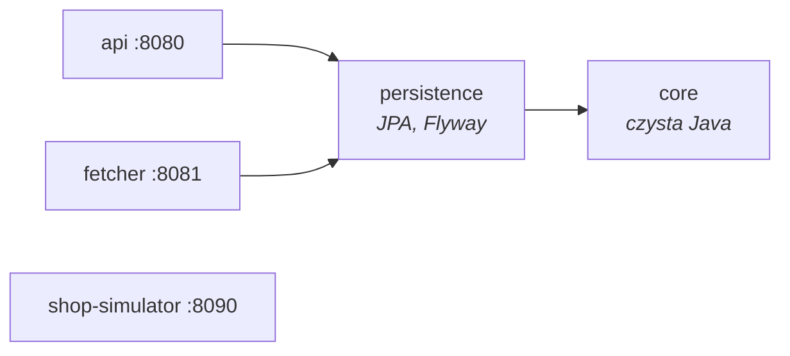
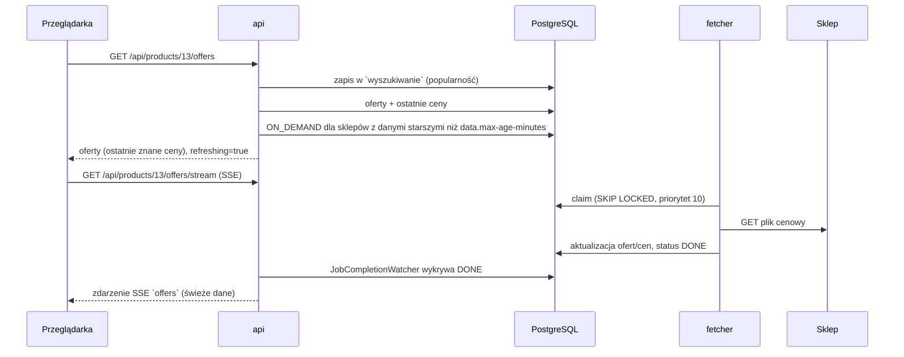
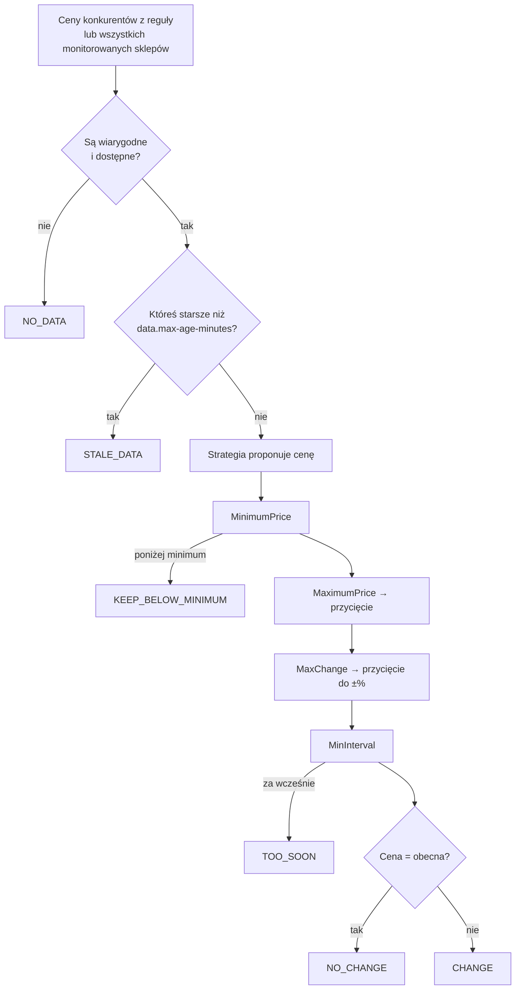

# Dokumentacja techniczna – Price Monitor

Dokument opisuje, **jak działa kod**: architekturę, przepływ danych, algorytmy i miejsca rozszerzeń.
Uruchomienie i przebieg eksperymentu opisuje [README](../README.md), pełną dokumentację endpointów – [API.md](API.md); tutaj nie są powtarzane.

## Spis treści

1. [Architektura](#1-architektura)
2. [Przepływ danych](#2-przepływ-danych)
3. [Kolejka zadań pobierania](#3-kolejka-zadań-pobierania)
4. [Model dwutorowy i popularność](#4-model-dwutorowy-i-popularność)
5. [Dopasowywanie ofert do produktów](#5-dopasowywanie-ofert-do-produktów)
6. [Moduł dynamicznych cen](#6-moduł-dynamicznych-cen)
7. [Formaty plików cenowych](#7-formaty-plików-cenowych)
8. [Model danych](#8-model-danych)
9. [Konfiguracja](#9-konfiguracja)
10. [REST API – konwencje i błędy](#10-rest-api--konwencje-i-błędy)
11. [Symulator sklepów](#11-symulator-sklepów)
12. [Testy](#12-testy)
13. [Jak rozszerzać system](#13-jak-rozszerzać-system)
14. [Ograniczenia i znane założenia](#14-ograniczenia-i-znane-założenia)

---

## 1. Architektura

### Moduły i zależności



| Moduł | Rola | Kluczowe pakiety |
|---|---|---|
| `core` | Logika domenowa bez Springa i bez I/O – można ją testować bez bazy i sieci. | `pricing` (silnik cenowy), `matching` (dopasowywanie), `feed` (wspólny model pliku cenowego) |
| `persistence` | Encje JPA, repozytoria, migracje Flyway, ustawienia systemu i popularność. Współdzielony przez `api` i `fetcher` (importują `PersistenceConfig`). | `entity`, `repository`, `service` |
| `api` | Aplikacja główna: REST + SSE, planowanie zadań, reakcja na zakończone zadania, dopasowywanie, moduł cenowy, e-mail. **Tylko ona migruje schemat.** | `product`, `matching`, `pricing`, `jobs`, `admin`, `notification` |
| `fetcher` | Proces roboczy: pobiera zadania z kolejki, ściąga i parsuje pliki cenowe, zapisuje oferty i ceny. Można uruchomić kilka instancji. | `queue`, `worker`, `feed`, `update` |
| `shop-simulator` | Niezależna aplikacja (bez zależności od pozostałych modułów): 5 sklepów z plikami cenowymi, scenariusz zmian cen, atrapa API sklepu sprzedawcy. | `web`, `scenario`, `feed` |

### Komunikacja między procesami

`api` i `fetcher` **nie wywołują się nawzajem przez HTTP**. Jedynym kanałem jest baza PostgreSQL:

- `api` wstawia wiersze do `zadanie_pobrania`,
- `fetcher` pobiera je (`FOR UPDATE SKIP LOCKED`), wykonuje i ustawia `DONE`/`FAILED`,
- `api` co 500 ms sprawdza zakończone zadania (`JobCompletionWatcher`) i reaguje na nie,
- ustawienia administratora (tabela `ustawienie`) są czytane przez oba procesy przy każdym użyciu, więc zmiana działa bez restartu.

Dzięki temu procesy można restartować i skalować niezależnie, a kolejka przetrwa awarię każdego z nich.

---

## 2. Przepływ danych

### Pierwszy start

1. `api` uruchamia migracje Flyway (`V1__schemat.sql`, `V2__dane_startowe.sql`).
2. `StartupImport`: jeśli tabela `oferta` jest pusta, planuje zadanie `IMPORT` dla każdego monitorowanego sklepu.
3. `fetcher` wykonuje importy – tworzy oferty i pierwsze wpisy w historii cen.
4. `JobCompletionWatcher` po każdym zakończonym `IMPORT` uruchamia `MatchingService.matchNewOffers()`.

### Zapytanie kupującego o ceny produktu (ścieżka „na żądanie”)



Kupujący dostaje odpowiedź od razu (ostatnie znane ceny + lista odświeżanych sklepów), a świeże dane przychodzą przez SSE.
Jeśli zadanie zakończy się błędem, przez SSE idzie zdarzenie `error` z nazwą sklepu.

### Co robi `JobCompletionWatcher` po zakończonym zadaniu

| Sytuacja | Reakcja |
|---|---|
| Zadanie `FAILED` | e-mail do administratora; jeśli zadanie dotyczyło produktu – zdarzenie SSE `error` |
| Zadanie `IMPORT` `DONE` | dopasowanie nowych ofert |
| Każde `DONE` | wyszukanie produktów, których ceny w tym sklepie zmieniły się od startu zadania → `PricingService.onPricesChanged()` |
| Każde `DONE` | wysłanie aktualnego stanu przez SSE (dla `ON_DEMAND` – tylko subskrybentom tego produktu, dla pozostałych – wszystkim subskrybentom) |

Błąd obsługi jednego zadania jest logowany i nie blokuje kolejnych.

---

## 3. Kolejka zadań pobierania

Tabela `zadanie_pobrania`, obsługa w `fetcher/.../queue/FetchJobQueue.java` (czysty SQL przez `JdbcTemplate`).

### Typy i priorytety

| Typ | Priorytet | Kto planuje | Zakres aktualizacji (`OfferUpdater`) |
|---|---|---|---|
| `ON_DEMAND` | 10 | `FetchJobScheduler.refreshIfStale` / `requestOnDemand` | tylko oferty wskazanego produktu |
| `CYCLIC` | 5 | `IndexingScheduler` (tryb `DUAL`) | znane oferty **popularnych** produktów |
| `IMPORT` | 1 | `StartupImport`, `IndexingScheduler`, `POST /api/admin/import` | wszystkie oferty, **tworzy nowe** |

Każde zadanie pobiera **cały plik cenowy sklepu** – typ zadania określa tylko, które oferty z pliku zostaną zapisane.

### Pobieranie zadania

```sql
UPDATE zadanie_pobrania z SET status = 'IN_PROGRESS', rozpoczeto = now(), liczba_prob = z.liczba_prob + 1
 WHERE z.id = (SELECT j.id FROM zadanie_pobrania j JOIN sklep s ON s.id = j.sklep_id
                WHERE j.status = 'PENDING'
                  AND j.nie_wczesniej_niz <= now()
                  AND (s.niedostepny_do IS NULL OR s.niedostepny_do <= now())
                ORDER BY j.priorytet DESC, j.utworzono
                LIMIT 1 FOR UPDATE OF j SKIP LOCKED)
RETURNING ...
```

- `SKIP LOCKED` – wiele instancji `fetcher` pobiera zadania równolegle, nigdy tego samego dwa razy i bez czekania na siebie.
- Zadania sklepu oznaczonego jako niedostępny czekają w kolejce zamiast ciągle się wywracać.
- Indeks częściowy `idx_zadanie_kolejka ... WHERE status = 'PENDING'` utrzymuje zapytanie szybkie mimo rosnącej historii.

### Deduplikacja

`FetchJobScheduler` nie tworzy zadania, jeśli takie samo (sklep + typ, a dla `ON_DEMAND` sklep + produkt) jest już `PENDING` lub `IN_PROGRESS`.
Wielokrotne odświeżanie strony przez wielu kupujących nie zalewa więc sklepu zapytaniami.

### Obsługa błędów (`FetchWorker`)

| Błąd | Reakcja |
|---|---|
| Błąd sieci / timeout / odpowiedź nie-2xx (`RestClientException`) | ponowienie z opóźnieniem `retry-base-delay × 2^(próba−1)` (5 s, 10 s, …); po `max-attempts` (3) – `FAILED` i sklep niedostępny przez `shop-unavailable-for` (5 min) |
| Niepoprawny plik (`FeedParseException`) | od razu `FAILED` – ponawianie nic nie da |
| Sklep bez skonfigurowanego pliku | od razu `FAILED` |
| Inny wyjątek | `FAILED` z nazwą wyjątku |
| Proces padł w trakcie zadania | `StaleJobReaper` co minutę przywraca do `PENDING` zadania `IN_PROGRESS` starsze niż `stale-job-timeout` (2 min) |

Udane pobranie przywraca sklepowi status `AVAILABLE`.

### Grzeczne pobieranie

`ShopRateLimiter` pilnuje minimalnego odstępu między zapytaniami do jednego sklepu (`sklep.min_odstep_zapytan_s`, maks. 30 s czekania).
`FeedClient` ma ścisłe limity czasu: połączenie 2 s, odczyt 4 s, i przedstawia się nagłówkiem `User-Agent`.

### Zapis wyników (`OfferUpdater`)

- Nowa oferta powstaje tylko przy `IMPORT`.
- Nowy wiersz w `cena` jest dopisywany **tylko gdy zmieniła się** cena, koszt dostawy lub dostępność – historia nie puchnie od identycznych odczytów. `oferta.ostatnie_pobranie` jest aktualizowane zawsze (potwierdza świeżość danych).
- Oferta z zakresu zadania, której zabrakło w pliku, dostaje wpis „niedostępna” z ostatnią znaną ceną.
- Stan towaru: sygnał z nazwy („outlet”, „używany”, „odnowiony”…) ma pierwszeństwo przed polem z pliku; brak informacji = `NEW`.

---

## 4. Model dwutorowy i popularność

**Popularność** (`PopularityService`) = liczba wpisów w `wyszukiwanie` dla produktu w oknie `popularity.window-days`.
Wpis powstaje przy każdym `GET /api/products/{id}/offers` (wyszukiwanie po frazie też jest logowane, ale bez produktu).
Produkt jest popularny, gdy liczba wyświetleń ≥ `popularity.threshold`.

`IndexingScheduler` co 15 s sprawdza, czy minął `indexing.interval-minutes`, i w zależności od `indexing.mode`:

| Tryb | Ścieżka cykliczna | Ścieżka „na żądanie” | Pełny import |
|---|---|---|---|
| `DUAL` (proponowany) | `CYCLIC` – oferty popularnych produktów | tak, przy zapytaniu o produkt z nieaktualnymi danymi | co `import-interval` (6 h) |
| `CYCLIC_ONLY` (odniesienie) | `IMPORT` – wszystkie oferty co interwał | nie | – (zastąpiony przez cykl) |

Tryb i parametry czytane są z bazy przy każdym takcie, więc można je przełączać w trakcie eksperymentu.

---

## 5. Dopasowywanie ofert do produktów

Algorytm: `core/.../matching/OfferMatcher.java`, wykonanie i weryfikacja: `api/.../matching/MatchingService.java`.

### Kroki

1. **Odrzucenie używanych i odnowionych** – takie oferty nigdy nie są dopasowywane.
2. **Normalizacja** (`TextNormalizer`): małe litery, bez polskich znaków i interpunkcji, `128 GB` → `128gb`; GTIN – same cyfry bez wiodących zer (GTIN-12/13/14 są porównywalne); MPN – wielkie litery i cyfry.
3. **Atrybuty wariantu** (`VariantAttributes`) – kolor, pamięć, rozmiar, region, zestaw. Łączone z dwóch źródeł: wyciągane z nazwy i jawne (z pliku/katalogu, mają pierwszeństwo). Klucze mają aliasy (`kolor`/`colour`/`color`, `pamiec`/`dysk`/`storage`…), wartości są ujednolicane (`Czarne`/`czarny`/`black` → `czarny`). Przy kilku pojemnościach w nazwie (RAM + dysk) wygrywa większa.
4. **Identyfikatory**: zgodny GTIN (pewność 1,000), potem MPN (0,970). Jeśli atrybuty wariantu są **sprzeczne** – mimo zgodnego identyfikatora status `TO_REVIEW` (0,800).
5. **Marka, model i atrybuty** – kandydaci z tą samą marką (jeśli oferta ją podaje), bez sprzecznych atrybutów i bez „dodatkowego” słowa linii modelu (`pro`, `max`, `ultra`, `plus`, `mini`, `slim`, `digital`, `fe`, `se`…), którego nie ma w produkcie. Pierwszeństwo ma produkt, którego wszystkie słowa modelu występują w nazwie oferty, potem wyższe podobieństwo trigramowe.
6. **Podobieństwo trigramowe** (`TrigramSimilarity`) – liczone tak jak `pg_trgm` w PostgreSQL: |A∩B| / |A∪B|.

### Decyzja

Progi z `pricemonitor.api.matcher-accept-threshold` (domyślnie 0,55) i `matcher-review-margin` (0,10):

| Warunek | Metoda | Status |
|---|---|---|
| zgodny model, podobieństwo ≥ 0,45, atrybuty pełne | `ATTRIBUTES` | `AUTOMATIC` |
| zgodny model, podobieństwo ≥ 0,45, brak części atrybutów | `ATTRIBUTES` | `TO_REVIEW` |
| podobieństwo ≥ 0,55 i atrybuty równe | `NAME` | `AUTOMATIC` |
| podobieństwo w przedziale [0,45; 0,55) lub atrybuty niepełne | `NAME` | `TO_REVIEW` |
| podobieństwo < 0,45 | – | brak dopasowania |

### Cykl życia dopasowania

- `matchNewOffers()` bierze oferty, które **nigdy** nie przeszły dopasowania (brak produktu i brak wiersza w `dopasowanie`). Oferta bez wyniku zostaje bez dopasowania i będzie próbowana ponownie.
- `AUTOMATIC` od razu ustawia `oferta.produkt_id`. `TO_REVIEW` czeka na człowieka: `approve` ustawia produkt, `reject` go zdejmuje.
- `POST /api/matches` – ręczne dopasowanie (`MANUAL`, od razu `APPROVED`).

### Zasady użycia (`MatchPolicy`)

- **W porównaniu cen** widoczne są dopasowania `AUTOMATIC` i `APPROVED`. Te oparte na nazwie lub atrybutach mają flagę `lowConfidence: true`.
- **W decyzjach cenowych** liczą się tylko dopasowania pewne: `APPROVED` albo `AUTOMATIC` przez identyfikator. Błędne dopasowanie po nazwie nie może więc samo obniżyć ceny sprzedawcy.

---

## 6. Moduł dynamicznych cen

Silnik: `core/.../pricing/PricingEngine.java` (czysta funkcja: wejście → decyzja).
Wykonanie: `api/.../pricing/PricingService.java`.

### Wyzwalacz

Po każdym zakończonym zadaniu pobierania `JobCompletionWatcher` znajduje produkty, których ceny się zmieniły, i dla każdej **aktywnej** reguły tych produktów wywołuje `PricingService.evaluate()`.
Sprzedawca może też uruchomić regułę ręcznie: `POST /api/sellers/{id}/rules/{ruleId}/evaluate`.

### Przebieg decyzji



### Strategie (wzorzec Strategia)

| `StrategyType` | Parametr (domyślnie) | Proponowana cena |
|---|---|---|
| `MATCH_LOWEST` | – | najniższa cena konkurencji |
| `UNDERCUT_AMOUNT` | `amount` (1,00) | najniższa − kwota |
| `UNDERCUT_PERCENT` | `percent` (1) | najniższa − procent |
| `AVERAGE_BAND` | `band` (5) | bez zmian, jeśli cena mieści się w ±`band`% średniej; inaczej najbliższa granica pasma |

Parametry są zapisane jako tekst (JSONB); przecinek dziesiętny jest akceptowany, wartości ujemne są odrzucane.

### Ograniczenia (łańcuch odpowiedzialności)

Stosowane zawsze w tej kolejności i zawsze ważniejsze od strategii:

1. **`MinimumPriceConstraint`** – nigdy poniżej `cena_min`. Gdy strategia proponuje mniej, cena **zostaje** (`KEEP_BELOW_MINIMUM`), a sprzedawca dostaje informację – decyzja o obniżce należy do niego.
2. **`MaximumPriceConstraint`** – przycina do `cena_max` (opcjonalna).
3. **`MaxChangeConstraint`** – jednorazowa zmiana najwyżej o `max_zmiana_proc`% obecnej ceny.
4. **`MinIntervalConstraint`** – co najmniej `min_odstep_min` minut od ostatniej **zastosowanej** zmiany. Chroni przed pętlą, w której algorytmy różnych sprzedawców reagują na siebie nawzajem.

Wszystkie kwoty są zaokrąglane do grosza (`HALF_UP`). Uzasadnienie decyzji (`reason`) jest budowane po polsku krok po kroku i trafia do e-maila i historii.

### Wykonanie decyzji

| Wynik | `AUTOMATIC` | `NOTIFY` |
|---|---|---|
| `CHANGE` | zmiana ceny przez API sklepu → `APPLIED` + e-mail; błąd API → `FAILED` + alert do administratora | e-mail z rekomendacją → `SENT` |
| `KEEP_BELOW_MINIMUM` | `KEPT` + e-mail | `KEPT` + e-mail |
| `STALE_DATA` | zadania `ON_DEMAND` dla nieaktualnych sklepów – reguła zostanie oceniona ponownie po ich zakończeniu | jak obok |
| `NO_CHANGE`, `TOO_SOON`, `NO_DATA` | tylko log | tylko log |

Wiadomości `SENT` i `KEPT` nie są powtarzane, dopóki najniższa cena konkurencji się nie zmieni.
Obecna cena sprzedawcy jest zawsze czytana na żywo z API jego sklepu (`SellerShopClient`, nagłówek `X-Api-Key`).

---

## 7. Formaty plików cenowych

Oba parsery zwracają wspólny model `FeedOffer`. Ceny akceptują formy `1299.00`, `1 299,00`, `1299`; flagi – `1`/`true`/`tak`/`yes`.
Brak `id`, nazwy lub ceny albo cena ujemna → `FeedParseException` (zadanie od razu `FAILED`).

**JSON** (`JsonFeedParser`):

```json
{"shop": "ElektroMax", "generatedAt": "...", "offers": [
  {"id": "S1-1000", "name": "...", "brand": "Apple", "gtin": "...", "mpn": "...",
   "attributes": {"kolor": "czarny"}, "condition": "new", "price": "3999.00", "shipping": "0.00",
   "available": true, "url": "..."}]}
```

**XML** (`XmlFeedParser`, format zbliżony do polskich porównywarek):

```xml
<offers>
  <o id="CS-1001" url="..." price="3949.00" ship="9.99" avail="1" stan="nowy">
    <name>Smartfon Apple iPhone 16 128GB Czarny</name>
    <attrs><a name="Producent">Apple</a><a name="EAN">...</a><a name="Kod_producenta">...</a><a name="Kolor">czarny</a></attrs>
  </o>
</offers>
```

Atrybuty `Producent`/`Marka`/`Brand`, `EAN`/`GTIN` i `Kod_producenta`/`MPN` są mapowane na pola, pozostałe trafiają do `attributes`.
Parser jest strumieniowy (StAX) z wyłączonymi DTD i encjami zewnętrznymi (ochrona przed XXE).

---

## 8. Model danych

Schemat: `persistence/src/main/resources/db/migration/V1__schemat.sql`. Nazwy tabel i kolumn – po polsku (zgodnie z ERD), wartości słownikowe – po angielsku (1:1 z enumami Javy).

| Tabela | Encja | Opis |
|---|---|---|
| `uzytkownik` | `AppUser` | role `BUYER`, `SELLER`, `ADMIN` |
| `sklep` | `Shop` | `MONITORED` (plik cenowy) lub `SELLER` (API sklepu sprzedawcy); status dostępności, `niedostepny_do`, odstęp zapytań |
| `produkt` | `Product` | katalog; GTIN, MPN, atrybuty wariantu (JSONB); indeks trigramowy na nazwie |
| `oferta` | `Offer` | oferta w sklepie, unikalna para (`sklep_id`, `id_w_sklepie`); `produkt_id` ustawiane po dopasowaniu; `ostatnie_pobranie` = świeżość |
| `cena` | `PriceRecord` | historia cen (tylko zmiany), źródło `IMPORT`/`CYCLIC`/`ON_DEMAND` |
| `dopasowanie` | `ProductMatch` | propozycja/wynik dopasowania: metoda, pewność, status, weryfikujący |
| `wyszukiwanie` | `SearchLog` | wyświetlenia i wyszukiwania – podstawa popularności |
| `regula_cenowa` | `PricingRule` | jedna reguła na parę (sprzedawca, produkt) |
| `regula_konkurent` | (relacja) | wybrani konkurenci reguły; brak wpisów = wszystkie monitorowane sklepy |
| `decyzja_cenowa` | `PricingDecisionRecord` | historia decyzji: `APPLIED`, `SENT`, `KEPT`, `FAILED` |
| `zadanie_pobrania` | `FetchJob` | kolejka zadań (rozdział 3) |
| `ustawienie` | `Setting` | ustawienia administratora (rozdział 9) |

Wyszukiwanie produktów (`ProductRepository.search`) łączy trzy warunki: podciąg nazwy (`ILIKE`), dokładny GTIN i `word_similarity ≥ 0,5` z `pg_trgm` (literówki, inna kolejność słów).

`V2__dane_startowe.sql` jest generowany skryptem `tools/generate_sample_data.py` (deterministyczny seed), który tworzy też `shop-simulator/src/main/resources/simulator-data.json`. **Nie edytuj tych plików ręcznie** – zmień skrypt i wygeneruj je ponownie, żeby katalog i sklepy pozostały spójne.

---

## 9. Konfiguracja

### Zmienne środowiskowe

| Zmienna | Domyślnie | Używa |
|---|---|---|
| `DB_PORT` | `5432` | `docker-compose.yml`, `api`, `fetcher` |
| `DB_URL` | `jdbc:postgresql://localhost:${DB_PORT}/pricemonitor` | `api`, `fetcher` (nadpisuje cały adres) |
| `DB_USER` / `DB_PASSWORD` | `pricemonitor` | `api`, `fetcher` |
| `MAIL_HOST` / `MAIL_PORT` | `localhost` / `1025` | `api` (Mailpit z `docker-compose.yml`) |

### `api` – `pricemonitor.api.*`

| Klucz | Domyślnie | Znaczenie |
|---|---|---|
| `matcher-accept-threshold` | 0.55 | próg akceptacji dopasowania po nazwie |
| `matcher-review-margin` | 0.10 | pas poniżej progu kierowany do weryfikacji |
| `sse-timeout` | 2m | czas życia połączenia SSE |
| `import-interval` | 6h | pełny import w trybie `DUAL` |
| `seller-api-timeout` | 3s | timeout API sklepu sprzedawcy |
| `admin-email`, `mail-from` | – | adresy powiadomień |

### `fetcher` – `pricemonitor.fetcher.*`

| Klucz | Domyślnie | Znaczenie |
|---|---|---|
| `poll-interval-ms` | 500 | odstęp między przebiegami pobierania zadań |
| `max-jobs-per-poll` | 20 | ile zadań maksymalnie w jednym przebiegu |
| `max-attempts` | 3 | próby przed `FAILED` |
| `retry-base-delay` | 5s | pierwsze opóźnienie ponowienia (potem ×2) |
| `connect-timeout` / `read-timeout` | 2s / 4s | limity HTTP do sklepu |
| `shop-unavailable-for` | 5m | jak długo sklep jest pomijany po `FAILED` |
| `stale-job-timeout` | 2m | po jakim czasie `IN_PROGRESS` wraca do kolejki |

`pricemonitor.scheduling.enabled=false` wyłącza wszystkie zadania harmonogramu w obu aplikacjach (używane w testach integracyjnych).

### Ustawienia w czasie działania (tabela `ustawienie`, `GET/PUT /api/admin/settings`)

| Klucz | Domyślnie | Walidacja |
|---|---|---|
| `popularity.threshold` | 15 | liczba > 0 |
| `popularity.window-days` | 7 | liczba > 0 |
| `data.max-age-minutes` | 30 | liczba > 0 |
| `indexing.interval-minutes` | 10 | liczba > 0 |
| `indexing.mode` | `DUAL` | `DUAL` lub `CYCLIC_ONLY` |

Nieznany klucz lub niepoprawna wartość → `400`, a żadna zmiana z żądania nie zostaje zapisana.

---

## 10. REST API – konwencje i błędy

Opis wszystkich endpointów: [API.md](API.md). Pełna interaktywna specyfikacja: Swagger UI pod `http://localhost:8080/swagger-ui.html`, przykłady – `requests.postman_collection.json`.

Błędy są zwracane jako **RFC 7807 Problem Details** (`ApiExceptionHandler`):

| Wyjątek | Status |
|---|---|
| `NotFoundException` | 404 |
| `IllegalArgumentException`, błąd walidacji `@Valid` | 400 |
| `ConflictException`, `IllegalStateException` | 409 |
| `RestClientException` (np. API sklepu sprzedawcy nie odpowiada) | 502 |

Konwencje:
- odpowiedzi to rekordy `*View` / `*Response` – encje JPA nie wychodzą poza warstwę serwisów,
- sprzedawca jest wskazywany w ścieżce (`/api/sellers/{sellerId}/...`) – do czasu wprowadzenia uwierzytelniania,
- `offers[].ageSeconds` to wiek danych oferty, `refreshing`/`refreshingShops` – sklepy, dla których trwa pobieranie,
- oferty są posortowane: najpierw dostępne, potem rosnąco po cenie.

---

## 11. Symulator sklepów

`shop-simulator` trzyma stan sklepów w pamięci (`ShopRegistry`), wczytany z `simulator-data.json`.

| Endpoint | Opis |
|---|---|
| `GET /shops/{s1..s5}/feed` | plik cenowy sklepu (JSON lub XML) |
| `POST /simulator/scenario/start?durationHours&fraction&seed&timeScale` | scenariusz zmian cen: zmienia się `fraction` ofert w losowych momentach; ten sam `seed` = identyczny plan |
| `POST /simulator/scenario/stop`, `GET /simulator/scenario` | zatrzymanie, status |
| `GET /simulator/changes` | lista wykonanych zmian (z czasem) |
| `GET /simulator/truth` | aktualne „prawdziwe” ceny – punkt odniesienia do pomiaru dokładności |
| `POST /simulator/reset` | przywrócenie cen początkowych |
| `POST /simulator/shops/{code}/failure?mode=DOWN\|SLOW\|NONE&delayMs` | wstrzykiwanie awarii (`DOWN` = 503, `SLOW` = opóźnienie) |
| `GET/PUT /seller/products...` | atrapa API sklepu sprzedawcy (wymaga `X-Api-Key`), `GET /seller/changes` – historia zmian ceny |

---

## 12. Testy

```bash
mvn verify      # wszystkie testy; integracyjne wymagają Dockera
```

| Moduł | Testy | Rodzaj |
|---|---|---|
| `core` | `PricingEngineTest`, `OfferMatcherTest`, `TextAndAttributesTest`, `FeedValuesTest` | jednostkowe, bez Springa |
| `fetcher` | `JsonFeedParserTest`, `XmlFeedParserTest` | jednostkowe |
| `fetcher` | `FetchJobQueueTest` | integracyjny (PostgreSQL w Testcontainers) – kolejność priorytetów, pomijanie niedostępnych sklepów i opóźnionych zadań, `complete`/`fail`/`retryLater`/`requeueStale`. Równoległe pobieranie przez kilka instancji nie jest testowane. |
| `api` | `PricingServiceTest` | jednostkowy z atrapami (Mockito) |
| `api` | `ApiIntegrationTest` | end-to-end przez MockMvc na prawdziwym PostgreSQL z danymi startowymi |
| `shop-simulator` | `FeedRendererTest`, `ScenarioPlannerTest` | jednostkowe |

Uwagi:
- **Testcontainers ≥ 1.21.4** jest wymagany przy Docker Engine 29+ (wersja ustawiona w `pom.xml` przez `testcontainers.version`). Starsza wersja nie łączy się z Dockerem, a testy z `disabledWithoutDocker = true` są wtedy **po cichu pomijane**, nie oblewane – przy podejrzanie małej liczbie testów sprawdź raport Surefire (`skipped`).
- `ApiIntegrationTest` jest `@Transactional` (każdy test wycofuje swoje zmiany), więc serwisy działają w transakcji testu. Zmiany zrobione przez JPA nie są widoczne dla zapytań `JdbcTemplate`, dopóki nie wywołasz `em.flush()`.
- Profil `-Pcoverage-check` wymaga 90% pokrycia linii w `core`.
- CI (`.github/workflows/ci.yml`) uruchamia `mvn -B verify` na Ubuntu z JDK 21 dla pushy do `main` i dla pull requestów.

---

## 13. Jak rozszerzać system

**Nowa strategia cenowa**
1. Dodaj wartość do `StrategyType`.
2. Napisz klasę implementującą `PricingStrategy` (parametry czytaj przez `StrategyParameters.decimal`).
3. Zarejestruj ją w domyślnym konstruktorze `PricingEngine`.
4. Rozszerz `CHECK` kolumny `regula_cenowa.strategia` **nową** migracją Flyway (`V3__...sql`) – nie edytuj istniejących migracji.

**Nowe ograniczenie** – implementacja `PriceConstraint`, dodana w odpowiednim miejscu listy w `PricingEngine`. Kolejność ma znaczenie: ograniczenia zatrzymujące (`stop`) powinny być przed przycinającymi, jeśli mają patrzeć na propozycję strategii.

**Nowy format pliku cenowego** – wartość w `FeedFormat`, bean `FeedParser` w `fetcher` (wykrywany automatycznie przez `FetchWorker`), rozszerzenie `CHECK` kolumny `sklep.format_danych`.

**Prawdziwy sklep sprzedawcy (np. WooCommerce)** – zaimplementuj operacje `currentPrice` i `updatePrice` z `SellerShopClient` dla `GET/PUT /wp-json/wc/v3/products/{id}`. Najlepiej wydziel interfejs i wybieraj implementację po typie sklepu.

**Nowe ustawienie administratora** – stała, wartość domyślna i walidator w `SystemSettings` oraz `INSERT` w nowej migracji.

---

## 14. Ograniczenia i znane założenia

- **Brak uwierzytelniania** – identyfikator sprzedawcy i weryfikującego jest w żądaniu; hasła w danych startowych to zaślepki.
- **Klucz API sklepu sprzedawcy** (`api_klucz_enc`) jest przechowywany jawnie mimo nazwy kolumny.
- **`api` działa w jednej instancji**: subskrypcje SSE, znacznik `JobCompletionWatcher` i czasy ostatniego cyklu w `IndexingScheduler` są trzymane w pamięci. Kilka instancji `api` powielałoby planowanie zadań i reakcje na nie. `fetcher` można skalować.
- **`ShopRateLimiter` działa w obrębie jednego procesu** – przy kilku instancjach `fetcher` odstęp zapytań do sklepu nie jest wspólny.
- Każde zadanie pobiera cały plik sklepu – przy plikach rzędu setek MB warto by przejść na pobieranie przyrostowe lub API sklepu.
- Po restarcie `api` `JobCompletionWatcher` zaczyna od ostatniego zakończonego zadania – zadania zakończone w czasie, gdy `api` nie działało, nie wyzwolą modułu cenowego ani dopasowania (dopasowanie nadrobi najbliższy import).
- Bez skonfigurowanego serwera SMTP powiadomienia są tylko logowane (`NotificationService`), a błąd wysyłki nie przerywa przetwarzania.
